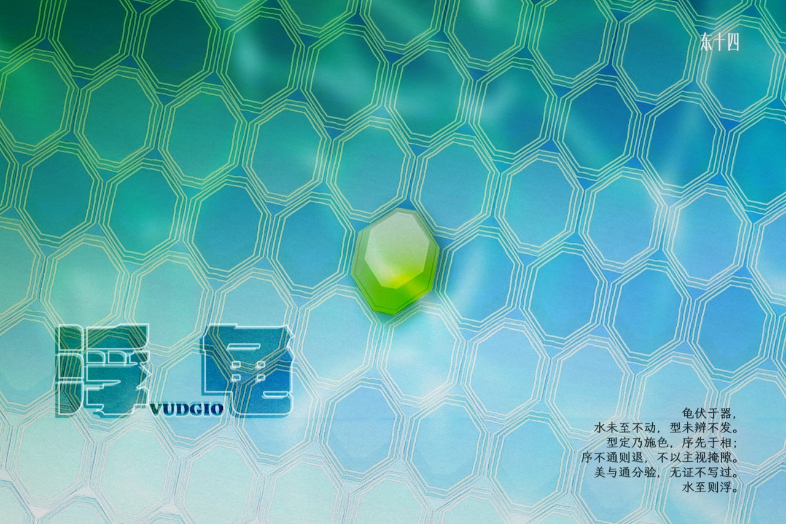
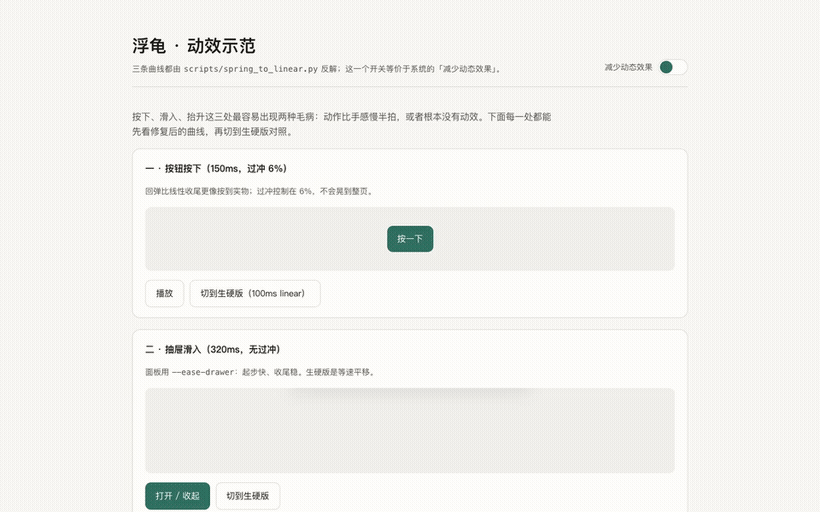

[中文](README.md) · English

# 浮龟 Vudgio

Chinese name 浮龟 (fú guī), Latin name *Vudgio* — the turtle that stays put until the water arrives. Package and directory names both use `vudgio`; search either 浮龟 or Vudgio.



## Install

Unzip the package (unzip it anywhere), then move the whole `vudgio/` folder into your agent's skills directory — the skills root your host scans. Verify with:

```bash
cd vudgio
python3 scripts/selftest.py          # expected: PASS; exit code 0
```

The self-check runs offline and needs no credentials. Reading exit codes: `0` = pass, `1` = criterion failed, `2` = usage/input error. For the full regression command (all 17 test modules), see the `tests/` entry under Layout below.

An **end-to-end interface design skill** for AI agents: direction → comparison → interface code → imagery → motion → review → delivery. Settle product facts and the surface's mode first, converge on one direction, refine against real screenshots, then have a reviewer who never saw the build process attack it.

It writes pages, components, motion and design assets directly (tokens, icons, placeholders, image prompts). It does not own business logic, APIs or data layers. Requests whose method is already fully stated (copy edits, count tweaks, removing an element, reusing existing styles) are just done, without the workflow.

## Commands

`做` `改` `比` `审` `简` `强` `弱` `字` `距` `动` `图` `严` `记` (build / refine / compare / review / subtract / bolder / quieter / type / spacing / motion / imagery / harden / document) — triggers, first-read volume and deliverable in `references/routing.md`. With no argument it lists the menu and never auto-runs one.

## Flow

1. **Facts and mode** — users, brand, task, real content, devices, assets, plus five checkable technical facts (framework/rendering, Tailwind major version, existing tokens, component library, dark mode). Write "not found" instead of guessing. Then pick Persuade, Operate, Read or Experience.
2. **Constraint brief** — content ranking, action ranking and token provenance go into the artifact as a leading comment. It must leave a trace.
3. **Direction** — one recommended direction with reasons, waiting for confirmation; a comparison board only when explicitly asked.
4. **Structure in grayscale** — one protagonist and one primary action per screen; pass grayscale before any colour; go back if the structure fails.
5. **Craft and feel** — type, spacing, colour, depth, motion in that order; new surfaces get the three baseline motions.
6. **Real evidence** — screenshots at 1280 and 375, 100% and 200%; motion via frame strips or live use. If you cannot see images, say the visual result is unverified.
7. **Independent review and delivery** — an isolated reviewer with no build-process context scores P0-P2; delivery states direction, changes, motion, review handling and where evidence lives.

## Layout

- `SKILL.md` — positioning, four modes, 13 commands, seven-step flow, delivery gate, index of 59 volumes (volume index in `references/index.md`), size budget
- `references/` — fifty-odd volumes of specific criteria, loaded per command and per problem, never end to end; new: `routing`, `craft-floor`, `tokens`, `build-recipes`, `type-and-polish`, `interaction-feel`, `review-rubric`
- `scripts/` — comparison board, screenshots, media curation, image processing, plus `check_contrast.py` (WCAG gate), `emit_tokens.py` (ramp generation and token export), and `spring_to_linear.py` (spring k/c → CSS `linear()` curve, or `--target 200 --overshoot 8` to solve back from the duration you want), `clip_audit.js` (shadow-clipping audit to paste into the browser; gate is `cut === 0`)
- `demo/` — `index.html` (the self-demo page: three motions, a hard-edged switch, a reduce-motion toggle) plus `motion-demo.gif` recorded from it
- `tests/` — `cd tests && python3 -m unittest test_check_contrast test_emit_tokens test_audit_palette test_measure_reference test_curate_media test_workdir test_spring_to_linear test_refs_toc test_refs_auth test_demo_page test_squircle_path test_glass_audit test_ci_coverage test_motion_audit test_clip_audit test_build_explorer test_prep_image test_take_shots -q` (18 modules; `test_take_shots` needs a local browser and is the slow one)

## Seeing the motion



One page, four segments, recorded from the real page (no mock): button press at 150 ms with 6% overshoot, drawer at 320 ms with `--ease-drawer`, tile lift at 200 ms with 8% overshoot, then the same press again with the reduced-motion switch on — the action still happens, it just lands at once.

Every curve in that page came out of `scripts/spring_to_linear.py`; nothing was hand-picked. Open `demo/index.html` to try the hard-edged version of each one (100 ms linear) and to flip the switch yourself.

Regenerate the clip:

```bash
node scripts/take_shots.mjs demo/index.html --size desktop --record --out demo/shots --hold 700 \
 --steps "press: click #press-play; wait 260" \
 --steps "drawer: click #drawer-play; wait 420" \
 --steps "lift: click #lift-play; wait 320" \
 --steps "reduced: click #rm; wait 120; click #press-play; wait 260"
# then concat the four record-*.mp4 in shoot order and GIF them with ffmpeg
```

## Workspace

Working files go in `.vudgio/<task-name>/` inside the project; real deliverables still go in the user's project. If the project already has `_work/` or `shots/`, follow it and don't create another. Folders left by earlier versions are not migrated or cleaned up.

## Maintenance

This skill is maintained on this machine as its own project: vendor sales copy and "full version" recommendation machinery are gone, the workspace directory is `.vudgio`, and local volumes for mobile, B2B, chat interfaces, materials and media were added.

**No external service is contacted**: there is no version checker, no self-updater and no credit-based image pipeline. The project is kept through `snapshot` cold archives (mode-skill); every local change is recorded in [CHANGELOG.md](CHANGELOG.md) (date / file / change / why).

The 2026-11-14 criteria merge: refactoring-ui (constraint and diagnosis), impeccable (command surface and craft floor), apple-design (feel), emil-design-eng (MIT, motion), design-taste-frontend (anti-AI tells). Criteria and pointers only; sources in `references/sources.md`.

## License and attribution

© 2026 L4ST-afk · MIT — see [LICENSE](LICENSE). Third-party attributions and full license texts are in [NOTICE](NOTICE) and [THIRD_PARTY_NOTICES.md](THIRD_PARTY_NOTICES.md); per-criterion provenance and boundaries are in `references/sources.md`. Contributions: [CONTRIBUTING.md](CONTRIBUTING.md). Past changes: [CHANGELOG.md](CHANGELOG.md) / [CHANGELOG.en.md](CHANGELOG.en.md).

