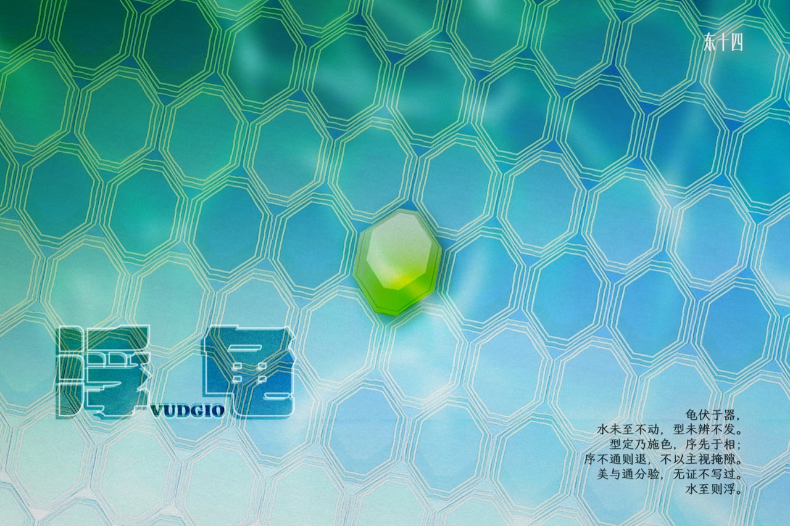
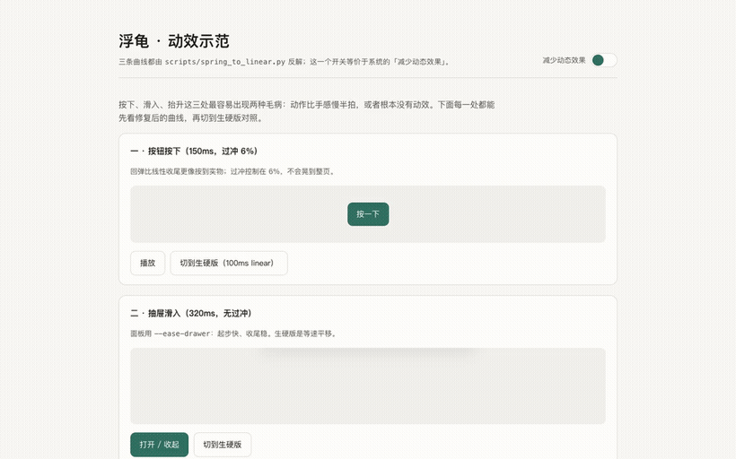

中文 · [English](README.en.md)

# 浮龟Vudgio

中文名浮龟，拉丁名 Vudgio，取「龟伏于器，水未至不动」；包名与目录名一律 `vudgio`，搜「浮龟」或 Vudgio 都能找到。名字只记取义，不影响任何判据。



## 安装

解压后把 `vudgio/` 整个目录移进你所用 agent 的 `skills` 目录（宿主扫描技能的那个文件夹）。自证：

```bash
cd vudgio
python3 scripts/selftest.py          # 期望 PASS，退出码 0
```

自检离线跑、不需要任何凭据。退出码：`0` 通过／`1` 判据不过／`2` 用法或输入错。完整回归命令（17 件测试）见下方「目录」里的 `tests/` 条目。

给 AI Agent 用的**界面设计总承包**：定方向 → 出对比 → 写界面 → 配图 → 动效 → 评 → 交。先定产品事实与这块面的型，收敛到一个方向，按真实画面打磨，最后由没看过制作过程的评审挑问题。

它能直接写页面、组件、动效与设计资产（令牌、图标、占位图、素材提示词）；不接业务逻辑、接口、数据层。改法已经说得很明白的日常修改（改文案、调数量、删元素、复用现有样式）直接改，不走流程。

## 命令

`做` `改` `比` `审` `简` `强` `弱` `字` `距` `动` `图` `严` `记`——触发语、先读哪份文档、交付什么都见 `references/routing.md`；无参数时只列菜单，不自动执行。

## 主流程

1. **事实与定型**：用户、品牌、任务、真实内容、设备、资产，以及五样可机判的技术项（框架与渲染方式、Tailwind 大版本、已有 tokens、组件库、暗色）。没读到写「未读到」，不推断；再定这块面是说服型、操作型、阅读型还是体验型。
2. **约束简报**：内容分级 + 动作分级 + 令牌来源写进产物文件头，必须留痕。
3. **方向**：默认给一个推荐方向并说明理由，等你确认；明确要比较时才开对比页。
4. **结构与灰度**：主角与主动作先定，灰度过关再上视觉；结构走不通就退回。
5. **质感与手感**：字、距、色、深、动依次上；新界面做三处基本动效。
6. **真实证据**：目标视口截图，1280 与 375、100% 与 200% 都看；动效看序列图或实操；看不了图就写「未验证实际视觉」。
7. **独立评审与交付**：隔离上下文、不看制作过程的评审者按 P0-P2 挑问题；交付写清方向、改动、动效、评审处理与证据位置。

## 目录

- `SKILL.md`：定位、四型、13 条命令、七步主流程、交付前的检查、59 份参考文档的索引（在 `references/index.md`）、篇幅预算
- `references/`：五十余份专项判据，按命令先读几份、按问题顺带查，不要求通读；新增 `routing` / `craft-floor` / `tokens` / `build-recipes` / `type-and-polish` / `interaction-feel` / `review-rubric`
- `scripts/`：对比页生成、截图、素材检索、图片处理，以及 `check_contrast.py`（WCAG 门）、`emit_tokens.py`（色阶 + 令牌导出）、`spring_to_linear.py`（弹簧 k/c → CSS `linear()` 曲线；也可 `--target 200 --overshoot 8` 从想要的时长反解）、`clip_audit.js`（阴影裁切审计，贴进浏览器执行，判据 `cut === 0`）
- `demo/`：`index.html`（自我示范页：三处动效、生硬版对照开关、减少动态效果开关）与从它录出来的 `motion-demo.gif`
- `tests/`：`cd tests && python3 -m unittest test_check_contrast test_emit_tokens test_audit_palette test_measure_reference test_curate_media test_workdir test_spring_to_linear test_refs_toc test_refs_auth test_demo_page test_squircle_path test_glass_audit test_ci_coverage test_clip_audit test_build_explorer test_prep_image test_take_shots -q`（17 件；`test_take_shots` 需本机浏览器，最慢）

## 动效长什么样



一页四段，全部录自真页面（不是拼图）：按钮按下 150ms／过冲 6%，抽屉 320ms／`--ease-drawer`，卡片抬升 200ms／过冲 8%，最后打开「减少动态效果」再按一次——动作照样发生，只是一次到位。

页里每一条曲线都是 `scripts/spring_to_linear.py` 反解出来的，没有一条手调。想对照手感就打开 `demo/index.html`：每处都能一键切成生硬版（100ms 线性），开关也能自己拨。

重录这段（`take_shots.mjs` 逐段录，之后四段 mp4 按录制顺序 concat，再用 ffmpeg 转 GIF）：

```bash
node scripts/take_shots.mjs demo/index.html --size desktop --record --out demo/shots --hold 700 \
 --steps "press: click #press-play; wait 260" \
 --steps "drawer: click #drawer-play; wait 420" \
 --steps "lift: click #lift-play; wait 320" \
 --steps "reduced: click #rm; wait 120; click #press-play; wait 260"
```

## 工作区

过程文件写在项目里的 `.vudgio/<任务名>/`，正式交付仍写用户项目；项目已有 `_work/`、`shots/` 等约定时沿用，不另建。旧版本留下的过程目录不迁移、不清理。

## 维护与判据来源

本目录是一个独立维护的项目：销售话术与「完整版」推荐机制已移除，工作区目录为 `.vudgio`，并增补了移动端、B 端、聊天界面、材料与媒体等本地参考文档。

**不访问任何外部服务**：没有版本检查器、没有自更新脚本、没有积分制生图链路。靠 `snapshot`（mode-skill）冷存档；每一次本地改动都记在 [CHANGELOG.md](CHANGELOG.md)（日期／文件／改动／为什么）。

2026-11-14 的判据合流：refactoring-ui（约束与诊断）、impeccable（命令面与质量地板）、apple-design（手感）、emil-design-eng（MIT，动效）、design-taste-frontend（反 AI 腔），只收判据形态与指名指针，出处见 `references/sources.md`。

## 许可与署名

© 2026 L4ST-afk · MIT——见 [LICENSE](LICENSE)。第三方署名与许可全文见 [NOTICE](NOTICE) 与 [THIRD_PARTY_NOTICES.md](THIRD_PARTY_NOTICES.md)，逐条判据出处与边界见 `references/sources.md`。贡献规范见 [CONTRIBUTING.md](CONTRIBUTING.md)；变更台账见 [CHANGELOG.md](CHANGELOG.md) / [CHANGELOG.en.md](CHANGELOG.en.md)。

